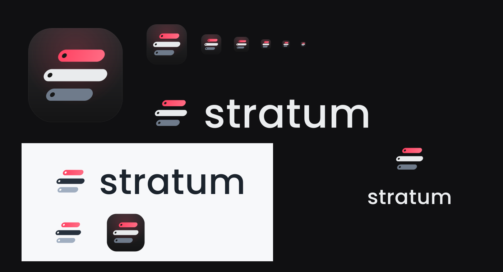

<picture>
  <source media="(prefers-color-scheme: dark)" srcset="stratum-brand/logo/stratum-logo-horizontal-on-dark.svg" />
  
</picture>

# Stratum

A DataGrip-style database IDE built on Electron, Monaco and the VS Code theme ecosystem.
Windows · macOS · Linux (native menu; global menu bar on macOS, and on Linux desktops with a DBusMenu host).



## Contents

- [What you get](#what-you-get)
- [Requirements](#requirements)
- [Install](#install)
- [Quick start](#quick-start)
- [Supported databases](#supported-databases)
- [The workbench](#the-workbench)
- [SQL completion](#sql-completion)
- [Query console](#query-console)
- [Results grid](#results-grid)
- [Table data editor](#table-data-editor)
- [Exporting data](#exporting-data)
- [Entity-relationship diagrams](#entity-relationship-diagrams)
- [Themes and appearance](#themes-and-appearance)
- [Settings](#settings)
- [Keyboard shortcuts](#keyboard-shortcuts)
- [Where your data lives](#where-your-data-lives)
- [Architecture](#architecture)
- [Development](#development)
- [Testing](#testing)
- [Packaging installers](#packaging-installers)
- [Project layout](#project-layout)
- [Maintenance scripts](#maintenance-scripts)
- [Upstream projects](#upstream-projects)
- [Troubleshooting](#troubleshooting)
- [License](#license)

## What you get

- **Data sources.** PostgreSQL, MySQL / MariaDB, SQLite, MongoDB, Redis, Elasticsearch, Cassandra, S3,
  FTP, Kafka and RabbitMQ work out of the box; anything with a JDBC driver (Oracle, Db2, SQL Server,
  Snowflake, ClickHouse…) works through the bundled
  [jdbc-adapter-server](https://github.com/database-client/jdbc-adapter-server) sidecar.
  Connections support SSL, a read-only mode, Test Connection, an SSH tunnel connection helper, and
  passwords are sealed with the OS keychain.
- **Docker helper.** The **Docker** tile in the connection dialog lists running containers over the
  local unix socket or TCP and fills Host/Port from a published port — plus the matching server type
  when the image is recognized. It is read-only: only `GET /containers/json` is ever called.
- **Database Explorer.** Schemas, tables, views, columns (with PK / FK badges and nullability), and
  indexes; a filter box; context menus for opening consoles, data editors and diagrams; plus
  light Rename… / Find Usages helpers that generate SQL instead of silently executing it.
- **SQL consoles.** Monaco with statement-under-caret execution, whole-script execution, cancel,
  per-connection history, and DataGrip-style SQL parameter prompts.
- **DataGrip-style completion.** Dialect-aware suggestions for 23 SQL dialects: aliases, qualified
  names, INSERT auto-fill, JOIN generation from foreign keys, live templates and a DataGrip-like
  ranker (match quality, label length, word usage).
- **Results grid.** Quick row filter, click-to-sort on any column, a value viewer that pretty-prints
  JSON, and incremental page fetching for large result sets.
- **Table data editor.** A `WHERE`/`ORDER BY` bar, paging, inline cell edits, add/delete rows, and a
  Submit that applies every pending change inside one transaction. Views and keyless tables stay
  read-only.
- **Exports.** Excel `.xlsx`, CSV (comma), TSV, pipe- and semicolon-separated, JSON, and
  dialect-quoted SQL `INSERT`s — all through native save dialogs. CSV files get a UTF-8 BOM so Excel
  opens accents correctly.
- **ER diagrams.** Schema graphs laid out by ELK with orthogonal edge routing, a table finder,
  neighbour focus, zoom/pan, and SVG / PNG / vector-PDF export.
- **VS Code themes.** Any color theme, file icon theme or product icon theme; installed VS Code /
  VSCodium / Cursor extensions are discovered automatically, and Dark / Light / System modes switch
  between sibling themes.

## Requirements

| | |
|---|---|
| Development | Node.js 18 or newer, npm |
| Running from source, Linux | an X11/Wayland session; `xvfb` only for `npm run smoke` |
| JDBC data sources | Java 11+ on `PATH`, or a `JAVA_HOME` configured in Settings |
| Everything else | bundled (Electron ships Chromium + Node; SQLite runs as WASM, so no native build step) |

## Install

### Ubuntu / Debian (.deb)

Build the package once (from the repository root):

```bash
npm install
npm run build            # bundles out/ (main + preload + renderer)
npm run fetch:jdbc       # optional: bundles the JDBC sidecar JAR
npx electron-builder --linux deb
```

Then install and launch:

```bash
sudo apt install ./dist/stratum_0.1.0_amd64.deb   # artifact name: stratum_<version>_<arch>.deb
stratum
```

`apt` resolves the runtime dependencies (GTK 3, NSS, libsecret and friends) automatically; all of
them ship with a standard desktop installation, so installing with
`sudo dpkg -i dist/stratum_*.deb` also works. The app installs under `/opt/Stratum` with a
`.desktop` entry; `apt remove stratum` uninstalls it.

If the app silently fails to open on Ubuntu 24.04+ (no window, nothing in the launcher), the
sandbox helper is missing its setuid bit — repair an existing install with:

```bash
sudo chown root:root /opt/Stratum/chrome-sandbox
sudo chmod 4755 /opt/Stratum/chrome-sandbox
```

Packages built from the current tree set this up in the post-install script, see
[Packaging installers](#packaging-installers).

### Other packages

`npm run dist` builds every target configured for the current OS in `electron-builder.yml`:
AppImage + deb + rpm on Linux, dmg + zip on macOS, NSIS + portable on Windows. Installers must be
built on (or for) each OS.

## Quick start

1. **Add a data source.** Press `Ctrl/⌘+Alt+Shift+D` (or click **New Data Source…** on the welcome
   screen). Pick PostgreSQL, MySQL / MariaDB, SQLite, MongoDB, Redis, Elasticsearch, Cassandra, S3,
   FTP, Kafka, RabbitMQ or *Other (JDBC)*, fill in the fields — the **Docker** tile can fill
   host/port from a running container and the **SSH Tunnel** tab reaches any network source behind a
   jump host — and press **Test Connection** before **OK**.
   For SQLite you can also use **File → Open SQLite File…**, point the *File* field at a `.db` path,
   or use `:memory:` for a scratch database.
2. **Browse the schema.** Expand the connection in the side bar: schemas → tables/views → columns
   (PK/FK colored) and indexes. The filter box narrows the tree; arrow keys navigate, `Enter`
   opens. Right-click a table for *Open Data Editor*, *Show Diagram (neighbours)*,
   *Select \* in Console*, *Rename…* and *Find Usages*.
3. **Run SQL.** The console opens automatically per connection. `Ctrl/⌘+Enter` executes the
   statement under the caret, `Ctrl/⌘+Shift+Enter` executes the whole script, `Ctrl/⌘+F2` cancels.
   Parameters such as `:id` or `${table}` prompt before running and are remembered.
4. **Edit data.** The data editor shows 500 rows per page with a `WHERE` / `ORDER BY` bar. Double-click
   a cell to edit, use the toolbar to add/delete rows, then `Ctrl/⌘+Alt+Enter` (Submit) to apply all
   pending changes in one transaction — or Revert to discard them.
5. **Draw the schema.** *Database → Show Diagram* (`Ctrl/⌘+Alt+U`) renders the current data source;
   right-clicking a table offers *Show diagram (neighbours)* to focus on its FK neighbourhood.
6. **Make it yours.** `Ctrl/⌘+K Ctrl/⌘+T` picks a color theme; Settings (`Ctrl+Alt+S`, or `⌘,` on
   macOS) covers fonts, completion, query safety and the JDBC sidecar.

## Supported databases

| Connection type | Driver | Notes |
|---|---|---|
| PostgreSQL | `pg` (bundled) | SSL toggle; read-only enforced with `default_transaction_read_only`. |
| MySQL / MariaDB | `mysql2` (bundled) | SSL toggle; read-only enforced with `session transaction read only`; big numbers arrive as strings. |
| SQLite | `sql.js` (WASM, bundled) | No native modules; file or `:memory:`; writes persist to the file after each write outside an open transaction. |
| MongoDB | `mongodb` (bundled) | Documents, not SQL: the console speaks mongosh-style expressions, collections load read-only in the data editor, and the Explorer shows databases → collections → sampled fields and indexes. |
| Redis | `ioredis` (bundled) | Key-value, not SQL: the console takes `redis-cli` commands under a read-only allowlist, keys load as paged values in the data editor, and the Explorer shows databases → sampled keys with their type. |
| Elasticsearch | `fetch` (HTTP, no extra dependency) | Search engine, not SQL: the console takes Dev Tools-style requests (`GET /_cat/indices?format=json`, `POST /index/_search` + JSON body) under a read-only allowlist, indices load as paged hits in the data editor, and the Explorer shows one `indices` schema with mapping columns. |
| Cassandra | `cassandra-driver` (bundled) | CQL, not SQL: the console takes `SELECT`, `USE` and client-side `DESCRIBE` under a read-only allowlist, tables load with page-state paging in the data editor, and the Explorer shows keyspaces → tables → columns (partition/clustering keys marked). |
| S3 | `@aws-sdk/client-s3` (bundled) | Object storage, not SQL: no console in this MVP; buckets list in the Explorer and each one opens a read-only `objects` grid (root listing: objects plus folder prefixes, paged by continuation token). Works with AWS and S3-compatible endpoints (MinIO, R2…). |
| FTP / FTPS | `basic-ftp` (bundled) | File transfer, not SQL: no console in this MVP; the Explorer shows the root folders as tables under one `files` schema and each opens a read-only grid (name, type, size, modified, permissions). Explicit FTPS (`AUTH TLS`) via the SSL switch. |
| Kafka | `kafkajs` (bundled) | Event streams, not SQL: no console in this MVP; the Explorer lists user topics and each opens a read-only peek (partition, offset, timestamp, key, value, headers) bounded by retained offsets, 5 000 messages and a 10 s budget. SASL/PLAIN and SSL supported; offsets are never committed. |
| RabbitMQ | `fetch` (Management HTTP API, no extra dependency) | Message broker, not SQL: no console in this MVP; the Explorer lists vhosts → queues and each opens a read-only peek (exchange, routingKey, redelivered, payload, properties, headers). Peeking requeues (`ack_requeue_true`); nothing is acknowledged or deleted. |
| Other (JDBC) | jdbc-adapter-server (bundled sidecar) | Any JDBC driver JAR; choose the SQL dialect used for quoting/completion. |

Every network source above can ride an **SSH tunnel** (see [SSH tunnels](#ssh-tunnels-connection-helper)).

Anything with a JDBC driver already works through the generic JDBC transport. Engines without an ANSI
`information_schema` get catalog-specific introspection instead: Oracle (`ALL_*` dictionary views),
Db2 (`SYSCAT`), SAP ASE (`sysobjects`/`syscolumns`, DataGrip's bit-8 nullability mask), ClickHouse
(`system.*`), Cassandra CQL (`system_schema`) and BigQuery (region-scoped `INFORMATION_SCHEMA`). All
of these paths are covered by tests (`tests/db.test.ts`).

### MongoDB

MongoDB is the first provider that is not SQL, so the workbench reaches it through a capability
registry instead of the SQL-only paths: `src/shared/kinds.ts` marks each `DriverKind` as `sql` or not,
and the connection dialog, data editor, console and Explorer hide (or adapt) the SQL affordances for
non-SQL sources.

Statements are mongosh-style text — `db.users.find({age:{$gt:30}}).sort({age:1}).limit(20)`,
`db.orders.aggregate([…])`, `countDocuments`, `estimatedDocumentCount`, `distinct`,
`db.getSiblingDB("other").getCollection("logs-2024").find({})` — parsed by a hand-written reader
(`src/main/db/transports/mongodb.ts`), never `eval`. Writes and JavaScript (`deleteMany`, `updateOne`,
`dropDatabase`, arrow functions) fail fast with an explanatory message before reaching the server.
Argument documents accept unquoted keys, both quote styles and the `ObjectId`/`ISODate`/`NumberLong`/
`NumberInt`/`NumberDecimal`/`Timestamp`/`UUID` constructors.

Paging is injected as `.skip(offset).limit(n)`, unless the statement already carries its own `limit`,
in which case it runs as written. Introspection lists every visible database (`listDatabases`, capped
at 25), lists collections including views, samples 25 documents per collection to name and type the
fields (`_id` is the primary key) and reads `listIndexes`; `admin`, `config` and `local` are listed
but not sampled. The connection dialog accepts a `mongodb://…` connection string that overrides the
host/port/user/password/auth-source fields. The optional live suite is described under
[Testing](#testing).

### Redis (read-only)

Redis is the second non-SQL provider and shares the MongoDB pattern: a hand-written reader for
`redis-cli` text (`src/main/db/transports/redis.ts`) instead of `eval`, guarded by an allowlist of
read-only commands and subcommand families (`CLIENT LIST`, `OBJECT ENCODING`, `XINFO STREAM`,
`JSON.GET`…). Writes and stateful/admin commands (`SET`, `DEL`, `FLUSHALL`, `EXPIRE`, `EVAL`,
`CONFIG`, `SUBSCRIBE`, `SORT … STORE`…) fail fast with an explanatory message in the results pane
before reaching the server; `SELECT` is allowed because it only changes which database the session
queries. Arguments parse like redis-cli's `sdssplitargs` (`"…"` with `\n`/`\xHH` escapes, `'…'`
literal), and replies become grid rows per shape: flat maps as field/value pairs, `SCAN`/`SSCAN`/
`HSCAN` with the cursor visible in its own column, `ZRANGE … WITHSCORES` as member/score pairs and
stream entries as id + JSON fields.

The Explorer maps databases to schemas (`db0`, `db1`…) and keys to tables. Introspection reads
`INFO keyspace`, samples up to 500 keys per database (2 000 total, 8 s budget) with `SCAN` on a
second (duplicated) connection — so user `SELECT`s never disturb it — and records each key's `TYPE`
as its column. Opening a key runs `INSPECT`, the paged reader the data editor drives: strings show
their value, hashes/lists/sets/zsets/streams show their natural columns with offset paging per type
(`LRANGE` windows, bounded `HGETALL`/`SSCAN` walks). Everything is read-only, like the MongoDB MVP.
The dialog accepts host/port, an ACL username/password, a database index (or a unix socket path),
and a connection string works for tests/tunnels (`redis://…`).

### Elasticsearch (read-only)

Elasticsearch is the third non-SQL provider and the first one that is pure HTTP: the transport
(`src/main/db/transports/elastic.ts`) speaks the Dev Tools dialect directly with `fetch` — no extra
dependency — and the console (`src/shared/elastic.ts`) splits requests at lines that start with an
HTTP method (`GET /_cat/indices?format=json`, `POST /my-index/_search` followed by a JSON body), so
a multi-line body never splits a statement. Only relative paths are accepted: the console can never
be pointed at an arbitrary host.

Reads are classified by method: `GET`/`HEAD` everywhere, `POST` only on search/count/analysis
endpoints (`_search`, `_search/template`, `_msearch`, `_count`, `_field_caps`, `_analyze`…).
Everything else — `PUT`, `PATCH`, `DELETE`, `POST /index/_doc`, `_bulk`, `_update_by_query`,
`_reindex`… — fails fast with an explanatory message in the results pane before a byte leaves the
process. A `GET` with a JSON body (Dev Tools style) is sent as `POST` on read endpoints, because
`fetch` cannot carry a GET body — anywhere else it is refused instead of silently becoming a write.
Search requests are paged like every other provider: the grid and the console add `from`/`size` to
`_search` calls, and the data editor drives its own `SEARCH <index>` reader (`sort: _doc` for stable
windows).

Search hits map to rows as `_id` plus flattened `_source` fields (dotted paths, up to depth 4);
`_cat/*?format=json` tables and plain JSON objects map generically, and server errors
(`index_not_found_exception`, …) become one readable line in the results pane. The Explorer shows a
single `indices` schema: indices as tables, mappings as columns (`name`, `name.keyword`,
`address.city`…, multi-fields included), fetched with an index cap and a time budget so a huge
cluster still introspects quickly. The dialog accepts host/port, an optional username/password and
an SSL switch; a full URL works for tests/tunnels (`uri`, `http://127.0.0.1:9200`).

### Cassandra (read-only)

Cassandra is the fourth non-SQL provider and speaks CQL through the official `cassandra-driver`
(`src/main/db/transports/cassandra.ts`). The console accepts `SELECT`, `USE` and client-side
`DESCRIBE KEYSPACES|TABLES|TABLE ks.tbl`; everything else — `INSERT`, `UPDATE`, `DELETE`,
`TRUNCATE`, `CREATE`/`ALTER`/`DROP`, `BATCH` — fails with an explanatory message in the results pane
before a statement reaches a node. `USE` is real session state: the transport validates the keyspace
and applies it per query through the driver's `keyspace` option, so it survives the driver's host
routing instead of depending on one connection.

CQL has no `OFFSET`, so paging is honest about it: a read is re-run from the first row and the
transport walks Cassandra's native page states (fetch size capped at 5 000, at most 20 000 rows
walked per query) until it reaches the requested window. The Explorer model comes from
`system_schema`: keyspaces are schemas, tables are tables, `partition_key`/`clustering_key` columns
are marked as primary keys and ordered first, and native types arrive as their full CQL type
(`frozen<map<text, int>>`…). The data editor opens a table with `SELECT *`, paged read-only like the
other non-SQL providers. The dialog accepts host/port, the local data center (default
`datacenter1`), an optional keyspace, username/password and SSL.

### S3 (read-only)

S3 is the first storage provider and has no console: it exists for browsing. The Explorer lists
buckets as schemas (`ListBuckets`) and every bucket exposes one `objects` table; opening it runs the
internal reader `LIST "<bucket>"` (`src/main/db/transports/s3.ts`), a `ListObjectsV2` root listing
with a `/` delimiter, so common prefixes arrive as `folder` rows next to object rows (`key`, `kind`,
`size`, `lastModified`, `storageClass`). Paging walks continuation tokens from the start — S3 has no
offset — capped at 10 000 rows and 1 000 keys per request. Any other statement is refused locally
with a pointer to the Explorer, and nothing in the transport writes.

Leave the endpoint blank for AWS S3 (the SDK's default endpoint and region chain); set host/port for
an S3-compatible service, which switches to path-style addressing and uses `http`/`https` by the SSL
switch (MinIO and friends). Credentials are optional — access key ID and secret key when provided,
otherwise the SDK's default provider chain (environment, profile, instance role).

### FTP (read-only)

FTP/FTPS is another browsing-only provider (`src/main/db/transports/ftp.ts`, `basic-ftp`). The
Explorer shows one `files` schema: `(root)` lists the server root and each root folder is a table
that lists that folder when opened — one level, since deeper navigation needs a console or a lazy
tree, and this MVP has neither. The internal reader `LIST "<path>"` maps the directory listing to
`name`, `type` (`file`/`folder`/`link`), `size`, `modified` (parsed date, raw server text as a
fallback) and `permissions` (symbolic `rwxr-xr-x`). FTP servers always return a whole directory, so
each call is capped at 10 000 entries and paging slices that snapshot locally. Nothing is uploaded,
renamed or deleted; every other statement is refused locally.

The dialog takes host/port and optional credentials (anonymous otherwise) and the SSL switch enables
explicit FTPS via `AUTH TLS`; implicit FTPS is not offered because it is the legacy variant. An SSH
tunnel works like it does for any other network source.

### Kafka (read-only)

Kafka is a peeking provider, not a SQL one (`src/main/db/transports/kafka.ts`, `kafkajs`). The
Explorer connects an admin client, hides internal topics (`__…`) and lists up to 200 user topics as
tables under one `topics` schema. Opening a topic runs the internal reader
`CONSUME "<topic>" <offset> <limit>`, which is deliberately bounded: it reads the retained
low/high offsets, subscribes from the beginning with a transient unique consumer group and
auto-commit disabled, then stops as soon as the requested window is filled, the retained messages
drain, or a 10 s budget expires — walking at most 5 000 messages. The budget is generous because
the first peek against a fresh broker pays for the consumer-group join. Nothing is produced and no offsets
are committed; the group disappears when the consumer disconnects. Paging therefore walks retained
messages from the earliest one, which keeps windows deterministic on quiet topics but means a very
large topic shows its oldest retained page first.

Rows are `partition`, `offset`, `timestamp`, `key`, `value` and `headers`. Keys and values decode as
UTF-8 when the bytes are valid (long text truncated) and render as `0x…` hex otherwise; headers are
a JSON object. The dialog takes one or more bootstrap brokers (`host1:9092,host2:9092`, or bare
hosts completed with the port field), optional SASL/PLAIN credentials, and the SSL switch. The SSH
tunnel can bridge a single broker only — a multi-broker list connects directly.

### RabbitMQ (read-only)

RabbitMQ rides the Management HTTP API, not AMQP (`src/main/db/transports/rabbitmq.ts`, `fetch` only).
The dialog takes the management host and port (15672 by default), optional basic-auth credentials and
the SSL switch; the AMQP port 5672 is not used. The Explorer reads `/api/queues` and shows one schema
per vhost with its queues as tables. Opening a queue runs the internal reader
`PEEK "<vhost>" "<queue>" <offset> <limit>`, a `POST …/get` with `ackmode: ack_requeue_true`,
`encoding: base64` and a 20 kB truncation: messages are delivered to the client and requeued
untouched — nothing is acknowledged, rejected, published, purged or deleted. The endpoint has no
offset, so each page requests `offset + limit` messages from the head (capped at 2 000) and slices
the window locally.

Rows are `exchange`, `routingKey`, `redelivered`, `payload`, `properties` and `headers`. Payloads
decode as UTF-8 when the bytes are valid (truncated at 2 000 characters, with `…` when the server cut
the body) and render as `0x…` hex otherwise; properties and headers show as JSON. RabbitMQ has no
console in this MVP: every other statement is refused locally. An SSH tunnel works like it does for
any other network source — point it at the management port.

### Docker helper (connection helper)

The **Docker** tile in the dialog is a read-only helper, not a data source
(`src/main/services/docker.ts`, `dockerode`). It reaches the daemon over the local unix socket
(`/var/run/docker.sock`, the default) or TCP (host/port, optional TLS), calls only
`GET /containers/json`, and lists running containers with image, status and published ports. Picking
a published TCP port fills **Host** and **Port** — `127.0.0.1` for the local socket, the TCP host for
a remote daemon — and selects the matching server type when the image gives it away: PostgreSQL,
MySQL/MariaDB, MongoDB, Redis, Elasticsearch/OpenSearch, Cassandra/Scylla, MinIO (S3), RabbitMQ
(management port 15672), Kafka and FTP. Companion UIs such as mongo-express or kafka-ui are ignored.
The helper never starts, stops or removes containers. Disable an active SSH tunnel first: published
ports are local, not reachable from the jump host.

### SSH tunnels (connection helper)

Any network data source can go through an SSH tunnel from the dialog's **SSH Tunnel** tab: host,
port, username, auth mode — `Auto` (offers password, a key and agent together, like DataGrip),
`Password`, `Key`, `Agent` — private key path (with `~` expansion and passphrase) and connect
timeout. `Auto` also looks for `~/.ssh/id_ed25519`, `id_rsa` and `id_ecdsa` and for `SSH_AUTH_SOCK`.

The main process (`src/main/services/sshTunnel.ts`) keeps one SSH connection per data source,
refcounted and promise-deduplicated: a `net` server on `127.0.0.1:0` accepts the database's sockets
and forwards each one with `forwardOut` to the real target, while the session runs against a
rewritten copy of the config — host/port, a `mongodb://`-style URI or a JDBC URL all point at the
local port, so transports never know SSH exists. `Test Connection` uses its own tunnel; closing the
session releases it; the last release tears the SSH connection down, and a dropped SSH connection
drops the entry so the next connect starts fresh. `mongodb+srv://` and comma-separated replica-set
hosts are rejected with an explanatory message (they need DNS/SRV resolution or several forwards),
as are unix sockets and SQLite. Host keys are accepted as presented in this build — a `known_hosts`
verifier is on the roadmap.

### JDBC sidecar details

- Get the JAR with `npm run fetch:jdbc` (downloads the latest release into
  `resources/jdbc-adapter/`). Alternatively point Stratum at any copy with the `STRATUM_JDBC_JAR`
  environment variable or **Settings → JDBC adapter → Server JAR**.
- One Java process is shared by every JDBC data source; it listens on `127.0.0.1:7823` by default
  (**Settings → Sidecar port**) and is started on demand.
- Java is taken from `PATH` unless **Settings → JAVA_HOME** is set.

## The workbench

The window is the familiar IDE layout:

- **Activity bar** (left or right, see `workbench.sideBar.position`): Database Explorer, New Query
  Console, Diagram, Find Action (`Ctrl/⌘+Shift+A`) and Settings. Hovering shows each action's
  name and shortcut.
- **Side bar:** the Database Explorer tree. Rows show connection state (color-coded), the server
  version, schema table counts, table/view icons, and for columns their data type, `not null`
  marker and PK/FK coloring; indexes show their columns and a `unique` badge.
- **Editor area:** tabs for consoles, table editors and diagrams. Console titles are numbered per
  connection (`shop.db console`, `shop.db [2]`…).
- **Status bar:** the active data source with its version, and the active color theme (click to
  change it).

The native menu (File / Edit / View / Run / Database / Help) exposes the same commands as the UI.
A tray icon shows or hides the window where the platform supports it, and all database sessions are
closed cleanly on quit.

## SQL completion

The completion engine (`src/shared/sqlComplete.ts`) is DataGrip-style and dialect-aware: scoped
aliases (reserved words never become implicit aliases), `schema.table.` qualifiers, INSERT column
auto-fill, JOIN generation from foreign keys, live templates (`sel`, `selw`, `selc`,
`lim`/`top`/`first`/`toprow`, `ins`, `upd`, `del`, `tab`, `view`, `col`) with DataGrip's
per-dialect availability, and per-dialect keyword and function catalogs for 23 dialects
(PostgreSQL, MySQL, MariaDB, SQLite, SQL Server, Oracle, Db2, Derby, H2, HSQLDB, SAP ASE,
Vertica, Exasol, Greenplum, Redshift, CockroachDB, Snowflake, ClickHouse, BigQuery, Hive,
Spark, Cassandra CQL, generic). Suggestions come back best-first with DataGrip-like ranking
signals (`src/shared/sqlRank.ts`): match quality (exact / prefix / middle / greedy), shorter
labels first, and word usage frequency in the console.

The Settings dialog can disable completion, turn off "suggest on space", enable automatic table
aliases, disable FK joins or live templates, and choose the keyword case (`UPPERCASE`, `lowercase`
or keep as typed).

DataGrip registers completion providers for reference expressions (aliases, tables, columns),
column lists (INSERT auto-fill), VALUES tuples, join smart completion, function definitions,
parameter names and parser-context keywords (dummy-identifier reparse + an ML ranker). Stratum
approximates that set with bounded statement scans and the heuristic ranker above; no DataGrip
model, code or ranking weights are copied.

The catalogs are *facts* extracted from the installed DataGrip 2026.2.6 modules (keyword
constant pools, the full `token("WORD")` lexer vocabulary and `functions.xml` per dialect)
into the generated `src/shared/sqlDialectData.ts`:

```
node scripts/datagrip-keywords.mjs <classes-dir> > keywords.json   # decodes *Keywords.class
node scripts/datagrip-tokens.mjs <modules-dir> > tokens.json       # decodes *Types.class (javap)
node scripts/datagrip-catalog.mjs keywords.json tokens.json <functions-dir> src/shared/sqlDialectData.ts
```

## Query console

- **Execution.** `Ctrl/⌘+Enter` runs the statement under the caret (with DataGrip's fallback to the
  preceding statement when the caret sits in blank space); `Ctrl/⌘+Shift+Enter` runs the whole
  buffer as a script. A statement that returns rows can be cancelled with `Ctrl/⌘+F2`.
- **SQL parameters.** `:name`, `:'name'`, `:"name"` (on dialects whose clients accept bind-style
  parameters — the PostgreSQL family, Oracle, Db2, H2, SQLite…), plus `${name}`, `$(name)` and
  `#name#` everywhere. A prompt collects the values before execution; quoted forms insert an
  escaped SQL literal, bind-style `:name` keeps numbers/NULL bare and quotes text, script forms
  substitute verbatim. Values are remembered per parameter name. The whole feature can be turned
  off with `query.parameters.enabled`.
- **Safety.** `query.confirmDestructive` (on by default) asks before running `UPDATE` / `DELETE`
  without a `WHERE` clause.
- **History.** Every executed statement is remembered per connection (newest first, toggle button in
  the toolbar); clicking an entry inserts it at the cursor.
- **Paging.** Results fetch `query.pageSize` rows (default 100) at a time; the results footer offers
  **Fetch next N** and **Fetch all** (capped at 50 pages per click, cancellable). The meta line
  shows `rows[+] · duration`.

## Results grid

Each statement's output gets its own result tab (error / table / checkmark icon), with:

- **Filter rows** — matches anywhere, case-insensitive, across every column (including inside JSON
  payloads). `Escape` clears it.
- **Column sort** — click a header to cycle ascending → descending → unsorted. Numbers sort
  numerically (including numeric-looking strings from drivers), nulls go last ascending, ties keep
  their original order.
- **Value viewer** — open a cell to see its full value; JSON payloads are pretty-printed and the
  whole text is copyable. `Escape` closes.
- **Grid** — windowed rendering for large results, resizable columns, a cell cursor, and copying of
  selected cells as TSV.
- **Errors** render as text under the tab instead of dialogs, and a failed incremental page fetch
  keeps the rows already loaded and shows the error in the footer.

## Table data editor

The data editor is data-centric: a `WHERE` and an `ORDER BY` input above the grid (both support bare
fragments, e.g. `id > 10` and `created_at desc`), 500 rows per page with Previous/Next.

- **Inline editing.** Double-click a cell, type, `Enter` commits into the pending-edit set
  (highlighted until submitted). Add row / Delete row operate on the current page; deleted rows are
  marked rather than hidden until you submit or revert.
- **Submit** (`Ctrl/⌘+Alt+Enter`) builds `UPDATE` / `DELETE` / `INSERT` statements with the
  connection's dialect quoting, keyed by the table's primary key, and applies them all inside one
  transaction — if anything fails, everything rolls back and the error is shown. The button label
  counts pending changes.
- **Read-only fallback.** Views and tables without a primary key (or sources with the read-only flag)
  open in a read-only grid with an explanatory hint.
- **Exports** use exactly what is on the grid (current page plus pending inserts).

## Exporting data

The export menu (results pane and data editor) offers DataGrip's CSV family plus JSON, SQL and Excel:

| Format | Notes |
|---|---|
| Excel (`.xlsx`) | Written natively (no dependency): typed cells, bold frozen header, sheet named after the table. |
| CSV (comma-separated) | "As-needed" quoting, LF records, UTF-8 BOM so Excel keeps accents. |
| Semicolon-separated | Same rules as CSV, for locales where `;` is the list separator. |
| TSV (tab-separated) | No BOM. |
| Pipe-separated | `.txt` files. |
| JSON | Pretty-printed array of objects keyed by column name. |
| SQL INSERTs | One statement per row, identifiers and literals quoted for the connection's dialect. |

Every export goes through a native save dialog; the [ERD](#entity-relationship-diagrams) has its own
image export menu.

## Entity-relationship diagrams

The ERD view renders a compact schema map: graph build → ELK layered placement → own orthogonal edge
routing → a pure SVG renderer (all of it testable without a browser, see `tests/db.test.ts`).

- **Toolbar:** fit to window (`0`), zoom out (`−`), percentage (click resets to 100%), zoom in (`+`),
  *Types* (show column types), *Views* (include views), *Refresh schema*, and *Export*; the right
  side shows `N tables · M relations`.
- **Finder:** type in the search box to highlight matching tables and see the hit count; clicking a
  node selects it.
- **Navigation:** the wheel/two-finger scroll pans; `Ctrl/⌘+wheel` (and trackpad pinch) zooms at the
  pointer; `+`/`-` zoom from the keyboard; `Escape` clears selection, search and menus. Resizes keep
  the diagram fitted until you pan or zoom by hand.
- **Context menu on a table:** open its data editor, copy the qualified name, or open a *neighbours*
  diagram with only its FK neighbourhood. Opening a diagram from the Explorer focuses the same way.
- **Exports:** SVG, PNG at 1× / 2× / 4×, and a single-page vector PDF sized to the diagram — with an
  optional transparent background for SVG and PNG. Exported files always use the standalone light
  palette on white, whatever theme the workbench uses.

## Themes and appearance

Any VS Code color theme, file icon theme or product icon theme works:

- **Built-ins** in `themes/`: Carbon Dark / Light (improved) and Min Dark / Light color themes, plus
  Carbon Product Icons Outline / Solid.
- **Drop-ins** in `<userData>/themes` — plain `.jsonc` or `.json` files.
- **Extensions:** installed VS Code / VSCodium / Cursor extensions are discovered automatically
  (their `contributes.themes`, `contributes.iconThemes` and `contributes.productIconThemes`), with
  `include` chains inlined and `vsix` icon fonts referenced through a restricted `stratum-asset://`
  protocol. Duplicates collapse, with local files winning over extension copies.

Colors become `--vscode-*` CSS variables (same names as VS Code), sparse third-party themes get
sane fallbacks for borders and scrollbars, and the Monaco theme is derived from the theme's
`tokenColors`. File icon themes resolve their icons (glyph or image) against the theme base, and
product icon themes re-map codicon glyphs.

**Appearance modes** (`appearance.mode`): Dark and Light pin a kind, System follows the OS live.
Switching modes moves to the active theme's sibling when one exists ("Min Dark" ↔ "Min Light",
"Carbon Dark" ↔ "Carbon Light") and falls back to the bundled Carbon theme of that kind. Picking a
theme explicitly pins its kind, like VS Code. `scripts/improve-themes.py` regenerates the improved
Carbon themes (visible borders, `tree.tableColumnsBorder`, `charts.*`) from the originals.

## Settings

Settings live in `<userData>/settings.json` and are editable both in the dialog (`Ctrl+Alt+S`, macOS
`⌘,`) — Appearance, Editor, SQL completion, Query execution, JDBC adapter, and a raw-JSON mode with
validation — and directly as JSON. Unknown keys pass through untouched; known keys are coerced to
safe values, and *Restore defaults* resets everything.

| Key | Default | Meaning |
|---|---|---|
| `appearance.mode` | `system` | `dark` / `light` pin a theme kind; `system` follows the OS. |
| `workbench.sideBar.position` | `left` | `left` / `right`; moves activity bar and side bar together. |
| `editor.fontFamily` | `""` | Monospace family; empty keeps the built-in chain (JetBrains Mono, SF Mono…). |
| `editor.fontSize` | `13` | 8–32. |
| `editor.tabSize` | `2` | 1–8. |
| `editor.wordWrap` | `off` | `on` / `off`. |
| `editor.minimap` | `false` | Monaco minimap. |
| `completion.enabled` | `true` | Master switch for SQL completion. |
| `completion.suggestOnSpace` | `true` | DataGrip-style suggestions after a space. |
| `completion.autoAlias` | `false` | Add aliases when completing table names. |
| `completion.snippets` | `true` | Live templates (`sel`, `ins`, `upd`…). |
| `completion.joinByForeignKey` | `true` | Generate JOIN clauses from foreign keys. |
| `completion.keywordCase` | `upper` | `upper` / `lower` / `preserve`. |
| `query.pageSize` | `100` | Rows fetched per page, 10–10000. |
| `query.confirmDestructive` | `true` | Ask before `UPDATE` / `DELETE` without `WHERE`. |
| `query.parameters.enabled` | `true` | Prompt for SQL parameters before running. |
| `query.parameters.values` | `{}` | Remembered parameter values, keyed by name. |
| `query.history` | `{}` | Per-connection console history (newest first). |
| `jdbc.port` | `7823` | Sidecar port (restarts the sidecar on change). |
| `jdbc.jarPath` | `""` | `jdbc-adapter-server.jar` location; empty uses the bundled copy or `STRATUM_JDBC_JAR`. |
| `jdbc.javaHome` | `""` | Java home for the sidecar; empty uses `java` from `PATH`. |
| `colorTheme`, `fileIconTheme`, `productIconTheme`, `colorScheme`, `windowBackground` | — | Managed by the theme manager. |

## Keyboard shortcuts

| Shortcut | Action |
|---|---|
| `Ctrl/⌘+Alt+Shift+D` | New Data Source… |
| `Ctrl/⌘+Shift+L` | New Query Console |
| `Ctrl/⌘+Alt+Y` | Refresh the Database Explorer |
| `Ctrl/⌘+Alt+U` | Show Diagram for the current data source |
| `Ctrl/⌘+Enter` | Execute the statement under the caret |
| `Ctrl/⌘+Shift+Enter` | Execute the whole script |
| `Ctrl/⌘+F2` | Cancel the running statement |
| `Ctrl/⌘+Alt+Enter` | Submit pending grid changes |
| `Ctrl/⌘+Shift+A` | Find Action (command palette) |
| `Ctrl/⌘+1` | Focus the Database Explorer |
| `Ctrl/⌘+4` | Toggle the results panel |
| `Ctrl/⌘+K` then `Ctrl/⌘+T` | Color Theme picker |
| `Ctrl+Alt+S` (macOS `⌘,`) | Settings |

File Icon Theme… and Product Icon Theme… live in the View menu (no default accelerator). In the ERD,
`0` fits, `+`/`-` zoom and `Escape` clears; in the Explorer, arrow keys navigate and `Enter` activates.

## Where your data lives

All application state lives under Electron's per-user data directory (`~/.config/Stratum` on Linux,
`~/Library/Application Support/Stratum` on macOS, `%APPDATA%\Stratum` on Windows):

| Path | Contents |
|---|---|
| `connections.json` | Data source configs, written atomically (temp file + rename). Passwords are sealed with the OS keychain (`safeStorage`) when available. |
| `settings.json` | Everything in the [Settings](#settings) table. |
| `themes/` | Drop-in VS Code themes (color, file icon, product icon). |

SQLite files are modified in place by the SQLite transport (written after each statement that
changes data, outside open transactions).

## Architecture

```
src/shared     contracts + pure logic: types, IPC API, SQL/provider parsers,
               allowlists, DML/quoting, exports, settings   (no runtime deps)
src/main       Electron main
  db/            providers: Transport (wire) × Dialect (SQL/model) = DbSession
  services/      ConnectionManager, SSH tunnels, Docker helper, JsonStore,
                 ThemeService, JdbcSidecar
src/preload    contextBridge: one typed `window.stratum` object
src/renderer   React workbench
  theme/         color → CSS vars + Monaco theme · file icon themes · product icon themes
  erd/           graph build → ELK placement → own orthogonal routing → pure SVG renderer
  workbench/     Explorer, Console, Table editor, Data grid, ERD view, dialogs, palette
```

The same structure as a generated dependency graph:

```mermaid
%% Generated by https://gitdiagram.com/lc-jhony/stratum
flowchart TD

subgraph group_workbench["Workbench"]
  node_app["Workbench shell<br/>[App.tsx]"]
  node_explorer["Database Explorer<br/>[Explorer.tsx]"]
  node_datasource["Data source setup"]
  node_diagramview["ER diagram view<br/>[ErdView.tsx]"]
  node_diagramlayout["Diagram layout<br/>[erd.ts]"]
  node_state["Workbench state<br/>[workbench.ts]"]
end

subgraph group_sql["SQL and results"]
  node_console["SQL console<br/>[ConsoleEditor.tsx]"]
  node_completion["SQL completion<br/>[sqlComplete.ts]"]
  node_params["Query parameters<br/>[sqlParams.ts]"]
  node_results["Results grid<br/>[DataGrid.tsx]"]
  node_tableeditor["Table data editor<br/>[TableEditor.tsx]"]
  node_export["Data export<br/>[export.ts]"]
end

subgraph group_database["Database access"]
  node_manager["Connection manager"]
  node_session["Database session<br/>[session.ts]"]
  node_dialects["Dialect introspection<br/>[dialects.ts]"]
  node_factory["Driver selection<br/>[factory.ts]"]
  node_transports["Database transports"]
  node_connections[("Connection store<br/>[store.ts]")]
  node_jdbc["JDBC sidecar<br/>[jdbcSidecar.ts]"]
end

subgraph group_platform["Electron platform"]
  node_preload["Preload bridge<br/>[index.ts]"]
  node_ipc["IPC handlers<br/>[ipc.ts]"]
end

subgraph group_appearance["Themes and settings"]
  node_settings["Settings storage<br/>[settings.ts]"]
  node_themeservice["Theme service<br/>[themeService.ts]"]
  node_thememanager["Theme manager<br/>[themeManager.ts]"]
  node_themeassets["Theme rendering<br/>[colorTheme.ts]"]
  node_icon["Themed icons<br/>[Icon.tsx]"]
end

node_user(("Database user"))

node_user -->|"uses"| node_app
node_app -->|"renders"| node_explorer
node_app -->|"renders"| node_console
node_app -->|"renders"| node_tableeditor
node_app -->|"renders"| node_diagramview
node_app -->|"loads"| node_state
node_user -->|"configures"| node_datasource
node_console -->|"suggests"| node_completion
node_console -.->|"prompts"| node_params
node_console -.->|"shows results"| node_results
node_tableeditor -.->|"exports"| node_export
node_diagramview -->|"lays out"| node_diagramlayout
node_explorer -->|"reads state"| node_state
node_state -->|"invokes API"| node_preload
node_preload -->|"forwards IPC"| node_ipc
node_ipc -->|"dispatches"| node_manager
node_ipc -->|"reads and writes"| node_connections
node_manager -->|"loads config"| node_connections
node_manager -->|"creates session"| node_factory
node_factory -->|"selects driver"| node_transports
node_factory -->|"uses JDBC"| node_jdbc
node_manager -->|"opens session"| node_session
node_session -->|"introspects"| node_dialects
node_session -->|"queries"| node_transports
node_thememanager -.->|"lists themes"| node_themeservice
node_thememanager -->|"applies theme"| node_themeassets
node_icon -->|"observes theme"| node_thememanager
node_icon -->|"resolves icons"| node_themeassets
node_thememanager -->|"loads preferences"| node_settings
node_ipc -.->|"serves theme API"| node_themeservice
node_state -->|"merges preferences"| node_settings

click node_app "https://github.com/lc-jhony/stratum/blob/main/src/renderer/src/App.tsx"
click node_explorer "https://github.com/lc-jhony/stratum/blob/main/src/renderer/src/workbench/Explorer.tsx"
click node_datasource "https://github.com/lc-jhony/stratum/blob/main/src/renderer/src/workbench/DatasourceDialog.tsx"
click node_console "https://github.com/lc-jhony/stratum/blob/main/src/renderer/src/workbench/ConsoleEditor.tsx"
click node_completion "https://github.com/lc-jhony/stratum/blob/main/src/shared/sqlComplete.ts"
click node_params "https://github.com/lc-jhony/stratum/blob/main/src/shared/sqlParams.ts"
click node_results "https://github.com/lc-jhony/stratum/blob/main/src/renderer/src/workbench/DataGrid.tsx"
click node_tableeditor "https://github.com/lc-jhony/stratum/blob/main/src/renderer/src/workbench/TableEditor.tsx"
click node_export "https://github.com/lc-jhony/stratum/blob/main/src/shared/export.ts"
click node_diagramview "https://github.com/lc-jhony/stratum/blob/main/src/renderer/src/workbench/ErdView.tsx"
click node_diagramlayout "https://github.com/lc-jhony/stratum/blob/main/src/renderer/src/erd/erd.ts"
click node_state "https://github.com/lc-jhony/stratum/blob/main/src/renderer/src/store/workbench.ts"
click node_preload "https://github.com/lc-jhony/stratum/blob/main/src/preload/index.ts"
click node_ipc "https://github.com/lc-jhony/stratum/blob/main/src/main/ipc.ts"
click node_manager "https://github.com/lc-jhony/stratum/blob/main/src/main/services/connectionManager.ts"
click node_session "https://github.com/lc-jhony/stratum/blob/main/src/main/db/session.ts"
click node_dialects "https://github.com/lc-jhony/stratum/blob/main/src/main/db/dialects.ts"
click node_factory "https://github.com/lc-jhony/stratum/blob/main/src/main/db/factory.ts"
click node_transports "https://github.com/lc-jhony/stratum/tree/main/src/main/db/transports"
click node_connections "https://github.com/lc-jhony/stratum/blob/main/src/main/services/store.ts"
click node_jdbc "https://github.com/lc-jhony/stratum/blob/main/src/main/services/jdbcSidecar.ts"
click node_settings "https://github.com/lc-jhony/stratum/blob/main/src/shared/settings.ts"
click node_themeservice "https://github.com/lc-jhony/stratum/blob/main/src/main/services/themeService.ts"
click node_thememanager "https://github.com/lc-jhony/stratum/blob/main/src/renderer/src/theme/themeManager.ts"
click node_themeassets "https://github.com/lc-jhony/stratum/blob/main/src/renderer/src/theme/colorTheme.ts"
click node_icon "https://github.com/lc-jhony/stratum/blob/main/src/renderer/src/workbench/Icon.tsx"

classDef toneNeutral fill:#f8fafc,stroke:#334155,stroke-width:1.5px,color:#0f172a
classDef toneBlue fill:#dbeafe,stroke:#2563eb,stroke-width:1.5px,color:#172554
classDef toneAmber fill:#fef3c7,stroke:#d97706,stroke-width:1.5px,color:#78350f
classDef toneMint fill:#dcfce7,stroke:#16a34a,stroke-width:1.5px,color:#14532d
classDef toneRose fill:#ffe4e6,stroke:#e11d48,stroke-width:1.5px,color:#881337
classDef toneIndigo fill:#e0e7ff,stroke:#4f46e5,stroke-width:1.5px,color:#312e81
classDef toneTeal fill:#ccfbf1,stroke:#0f766e,stroke-width:1.5px,color:#134e4a
class node_app,node_explorer,node_datasource,node_diagramview,node_diagramlayout,node_state toneBlue
class node_console,node_completion,node_params,node_results,node_tableeditor,node_export,node_user toneAmber
class node_manager,node_session,node_dialects,node_factory,node_transports,node_connections,node_jdbc toneMint
class node_preload,node_ipc toneRose
class node_settings,node_themeservice,node_thememanager,node_themeassets,node_icon toneIndigo
```



**Process model.** The renderer is a normal web app with no Node access: everything crosses a single
typed, request/response API (`src/shared/ipc.ts` → `window.stratum`) exposed by the preload script
over `ipcRenderer.invoke`. The main process pushes menu commands back as a `command` event.
Typed data ends where drivers begin: `normalize.ts` converts BigInt, Date, binary and object values
into JSON-safe representations once, at the IPC boundary. Database errors are *results*
(`QueryResult.error`), never exceptions thrown at the UI.

**Transport × Dialect.** Two orthogonal interfaces (`src/main/db/types.ts`):

- a **Transport** moves SQL to a database and rows back (`open` / `query` / `cancel` / `close`) and
  knows nothing about SQL dialects;
- a **Dialect** knows SQL text for one database family (`quote`, `qualify`, `paginate`,
  `introspect`) and knows nothing about wire protocols.

A `DbSession` (`src/main/db/session.ts`) composes one of each and adds policy: result paging
(`DEFAULT_PAGE` 500), read-only enforcement, error shaping, and transactional `submit`.

Add a database = one Transport (if it needs a new wire protocol) and/or one Dialect, registered in
`db/factory.ts` — the only place that knows which transport/dialect pairs exist. Anything with a
JDBC driver already works through the generic JDBC transport; providers that are not SQL (MongoDB,
Redis, Elasticsearch, Cassandra, S3, FTP, Kafka and RabbitMQ today) also register in
`src/shared/kinds.ts` so the UI hides the SQL affordances they cannot back. The Docker helper is not
a transport at all: it is a dialog pane that calls one read-only daemon endpoint through IPC.

**Services.** `ConnectionManager` owns live sessions per data source (open / close / test) and runs
each open through the SSH connection helper first — `sshTunnel.ts` keeps one refcounted tunnel per
data source and hands the session a rewritten config.
`JdbcSidecar` owns the single shared Java process behind the JDBC transport. `ThemeService` lists,
reads and imports themes and constrains the `stratum-asset://` protocol to theme roots.
`JsonStore` is the atomic JSON persistence used for both connections and settings,
with `safeStorage` password sealing.

**Shared contracts.** `src/shared` has no runtime dependencies and is imported by all three
processes: the SQL splitter (`sql.ts`, with DataGrip's statement-at-caret semantics), the provider
parsers and allowlists (`mongo.ts`, `redis.ts`, `elastic.ts`, `cassandra.ts`), provider capabilities
(`kinds.ts`), the Docker helper contract (`docker.ts`), the DML generator (`sqlgen.ts`), quoting
rules (`quoting.ts`), SQL parameters (`sqlParams.ts`), the completion engine and ranker
(`sqlComplete.ts`, `sqlRank.ts`), the result-view helpers (`gridView.ts`), the export writers
(`export.ts`, `xlsx.ts`) and the settings schema (`settings.ts`). That is what makes the non-UI half
of the app unit-testable in plain Node.

## Development

```bash
npm install
npm run dev            # electron-vite dev with HMR
npm run build          # bundle out/ (used by packaging and smoke)
npm run typecheck      # tsc --noEmit
npm test               # vitest: unit + SQLite end-to-end tests
npm run smoke          # builds, then drives the real app headless (needs xvfb)
npm run fetch:jdbc     # optional: download jdbc-adapter-server.jar
npm run pack           # unpacked app directory (electron-builder --dir)
npm run dist           # installers for the current OS
```

`npm run dev` hot-reloads the renderer and restarts the main process on change. `npm run smoke` sets
`STRATUM_SMOKE` to `scripts/smoke.js`, launches Electron under `xvfb-run --no-sandbox --disable-gpu`
and runs a scripted UI flow: it exercises the welcome screen, creates an in-memory SQLite database
with related tables, runs console queries, opens the table editor, drives the ERD finder, and
switches themes — surfacing everything found through the smoke hook (`?smoke=1` exposes
`window.__wb` and `window.__themes`).

`connect-to-server.html` is a standalone, single-file preview of the connection dialog: it mirrors
the four bundled color themes and can be opened directly in a browser. It is a design aid, not part
of the packaged application.

## Testing

`npm test` runs Vitest in a Node environment over `tests/**/*.test.ts`. The `*Live.test.ts` suites
are opt-in: each one skips unless its `STRATUM_TEST_*` variable is set, so the default run stays
offline and repeatable.

| Suite | Covers |
|---|---|
| `db.test.ts` | DbSession paging, errors-as-results, transactional submit, read-only; introspection of tables/views/PKs/FKs/indexes; ERD layout, overlap and themed SVG; engine-specific introspection (Oracle, ClickHouse, Cassandra, SAP ASE, Db2) against a fake runner. |
| `sql.test.ts` | Statement splitting (quotes, dollar-quoting, comments), caret semantics, `returnsRows`, DML generation. |
| `sqlComplete.test.ts` | Alias scoping, qualified names, INSERT auto-fill, FK join generation, preferences, dialect catalogs and template gating. |
| `sqlRank.test.ts` | Ranking signals: exact/prefix/middle/greedy, shorter labels, usage lift, bucket dominance. |
| `phase2.test.ts` | SQL parameter patterns and substitution; export formats (BOM, quoting, JSON, dialect-quoted INSERTs). |
| `gridView.test.ts` | Row filtering and column sorting (numbers, nulls, stability). |
| `settings.test.ts` / `store.test.ts` | Settings coercion and dialog preview semantics. |
| `theme.test.ts` | Color resolution and CSS vars, catalog dedupe, appearance modes and siblings, Monaco conversion, file/product icon themes. |
| `fonts.test.ts` / `xlsx.test.ts` | Font stacks; the XLSX writer (CRC-32, refs, sheet names, OOXML package, escaping, base64 round-trip). |
| `mongo.test.ts` | mongosh statement parser (JS-ish documents, BSON constructors, chain methods, rejects with messages), paging rewrite and read classification, BSON printing and document→row mapping; the shared MQL splitter and the capability registry. |
| `redis.test.ts` | redis-cli tokenizer (quotes and `sdssplitargs` escapes), statement splitter and caret, the read-only allowlist (accepts reads/subcommand families, rejects writes/admin/blocking), `INSPECT` paging rewrite, reply→grid mappings and the capability registry. |
| `elastic.test.ts` | Dev Tools splitter and caret, request parser (relative paths only), read-only allowlist (GET/HEAD, POST on read endpoints; rejects writes/bulk/reindex), `SEARCH` and `_search` paging rewrite, hit/`_cat`/object reply→grid mappings, and a full transport pass against an in-process fake cluster (connect, introspect, paging, blocked writes, server errors, read-only sources). |
| `cassandra.test.ts` | CQL classification past comments, read-only allowlist (SELECT/USE/DESCRIBE; rejects mutations/batches), `PAGE` header paging (CQL has no OFFSET), `USE` folding rules, `DESCRIBE` forms, and a full transport pass against an injected fake driver (connect, version, keyspaces/tables/PK-first columns, offset paging, session keyspace, blocked writes, read-only sources, driver errors). |
| `s3.test.ts` | Internal `LIST` reader and its paging rewrite, `ListBuckets`/`ListObjectsV2` command wiring (delimiter, token, page size), bucket→schema introspection, object and folder rows, continuation-token walking for offsets, console refusal, read-only sources and SDK errors, all against a fake command sink. |
| `ftp.test.ts` | Internal `LIST` path reader and its paging rewrite, anonymous/credentialed login wiring, root→folder introspection, row shaping for folders/files/links, dates and symbolic permissions, local window slicing, console refusal, read-only sources and client errors, against a fake client built on the real `FileInfo`. |
| `kafka.test.ts` | Broker-list parsing, internal `CONSUME` reader and paging rewrite, topic introspection with internal topics hidden, message decoding (UTF-8, binary hex, nulls, headers), offset windows, drained/empty topics, console refusal, read-only sources and admin/consumer errors, against a fake run-until-stopped consumer. |
| `rabbitmq.test.ts` | Internal `PEEK` reader and paging rewrite, Management API calls (basic auth, `ack_requeue_true`, base64, truncation), vhost→schema introspection, local window slicing, payload decoding, console refusal, read-only sources and 401/404 handling, against a real HTTP server. |
| `docker.test.ts` | Read-only `GET /containers/json` through dockerode (container/port mapping, sorting), unix-socket/TCP targets and actionable daemon errors, plus the image→server-type inference and companion exclusions used by the dialog helper, against a fake Engine HTTP server. |
| `tunnel.test.ts` | Tunnel target resolution (host/port, `mongodb://` URIs, JDBC URL shapes for MySQL/Postgres/SQL Server/Oracle) and rewrites that keep credentials, database and options; ssh2 client options per auth mode; a real handshake against an in-process sshd that proves bytes flow through `forwardOut`, that concurrent opens share one tunnel, and that the last release closes the listener. |

### Live checks

Live MongoDB checks are opt-in: point `STRATUM_TEST_MONGODB_URI` at any running server (or set
`STRATUM_TEST_MONGODB_MEMORY=1` to spawn an ephemeral one — needs `npm i --no-save mongodb-memory-server`)
and run `npx vitest run tests/mongoLive.test.ts`. The suite covers connect → introspect → paging →
aggregate/count/distinct → read-only guards end to end.

Live Redis checks follow the same switch: `STRATUM_TEST_REDIS_URI=redis://localhost:6379`, or
`STRATUM_TEST_REDIS_MEMORY=1` to spawn an ephemeral server (needs
`npm i --no-save redis-memory-server`), with `npx vitest run tests/redisLive.test.ts` — connect →
introspect (databases as schemas, types per key) → every console reply shape → write blocking →
`INSPECT` paging. And `STRATUM_TEST_MONGODB_MEMORY=1 npx vitest run tests/tunnelMongoLive.test.ts`
proves the Mongo driver reaches a real `mongod` *only* through an in-process SSH server, including
the tunnel release on `close()`.

Live Elasticsearch checks follow it too: point `STRATUM_TEST_ELASTIC_URL` at any cluster
(`STRATUM_TEST_ELASTIC_USER` / `STRATUM_TEST_ELASTIC_PASSWORD` are optional) and run
`npx vitest run tests/elasticLive.test.ts` — connect → introspect → `_cat` and search reads →
paging → blocked writes. The suite is read-only: it never creates or changes anything.

Live Cassandra checks only need a node: `STRATUM_TEST_CASSANDRA_CONTACT=127.0.0.1[:9042]`
(`STRATUM_TEST_CASSANDRA_DC`, `_USER`, `_PASSWORD` and `_KEYSPACE` are optional) plus
`npx vitest run tests/cassandraLive.test.ts` — connect → version → `SELECT`/`DESCRIBE` →
`system_schema` introspection → paging → `USE` → blocked writes. It reads `system` only, so it is
safe on a shared cluster.

Live S3 checks need one listable bucket: `STRATUM_TEST_S3_BUCKET=my-bucket` (optionally
`STRATUM_TEST_S3_ENDPOINT`, `_REGION`, `_ACCESS_KEY`, `_SECRET_KEY`, `_SSL=1`) and
`npx vitest run tests/s3Live.test.ts` — connect → buckets → a paged root listing → console refusal.
It only lists, never writes.

Live FTP checks need a server that allows listing: `STRATUM_TEST_FTP_HOST=127.0.0.1` (optionally
`_PORT`, `_USER`, `_PASSWORD`, `_SECURE=1`, `_PATH=/pub`) and `npx vitest run tests/ftpLive.test.ts`
— login → root folders → a paged directory listing → console refusal. It only logs in and lists.

Live Kafka checks need bootstrap brokers: `STRATUM_TEST_KAFKA_BROKERS=127.0.0.1:9092` (optionally
`_TOPIC`, `_SSL=1`, `_USER`, `_PASSWORD`) and `npx vitest run tests/kafkaLive.test.ts` — topic
listing → a bounded peek → console refusal. The peek uses auto-commit off and produces nothing.

Live RabbitMQ checks need the management plugin: `STRATUM_TEST_RABBITMQ_URL=http://127.0.0.1:15672`
(optionally `_USER`, `_PASSWORD`, `_VHOST`, `_QUEUE`) and `npx vitest run tests/rabbitmqLive.test.ts`
— version, queue listing and a bounded peek. It requeues; it never acknowledges, publishes or
deletes.

Live Docker checks need a daemon: `STRATUM_TEST_DOCKER=unix:///var/run/docker.sock` (or
`tcp://127.0.0.1:2375`) and `npx vitest run tests/dockerLive.test.ts` — two read-only container
listings and the published-port shape.

The smoke run complements them with an end-to-end pass through the real Electron renderer.

## Packaging installers

`electron-builder.yml` drives packaging:

- **App id** `dev.stratum.app`; app files are `out/**` plus `package.json`, with the `sql.js` WASM
  unpacked from the asar so it can be loaded.
- **Extra resources:** `themes/`, `resources/jdbc-adapter/` (populated by `npm run fetch:jdbc`) and
  the brand icons (window icon, tray icons including the macOS template variants).
- **Targets:** macOS `dmg` + `zip` (hardened runtime), Windows `nsis` + `portable`, Linux
  `AppImage` + `deb` + `rpm` (category *Development*, `StartupWMClass=stratum`).
- **deb dependencies:** the top-level `deb` block overrides electron-builder's default list to drop
  the legacy `libxss1` hard dependency — the packaged Electron neither links nor `dlopen`s
  `libXss.so.1`, so requiring it only made `dpkg -i` fail on distributions that no longer ship the
  library (Ubuntu 26.04) — and keeps `libxss1` and `libappindicator3-1` (tray indicator) as
  `Recommends`.
- **deb/rpm post-install:** `scripts/linux/after-install.tpl` replaces electron-builder's stock
  post-install script (wired through `afterInstall` for both targets). The stock script probes user
  namespaces as root (`unshare --user true`), which succeeds on every modern kernel, and then leaves
  `chrome-sandbox` at `0755`. On Ubuntu 24.04+ the AppArmor userns restriction
  (`kernel.apparmor_restrict_unprivileged_userns=1`) makes the namespace sandbox unusable for the
  real user, so Electron falls back to the SUID helper, finds it not setuid and aborts before the
  window opens. The custom script keeps the helper setuid root, like Chromium's own packaging.

The deb/rpm metadata (maintainer, homepage) comes from `author` and `homepage` in `package.json`.
Running a single target is fine too:

```bash
npx electron-builder --linux deb    # dist/stratum_<version>_<arch>.deb
npx electron-builder --linux rpm
npx electron-builder --mac dmg      # must run on macOS
```

## Project layout

```
connect-to-server.html  standalone connection-dialog preview (not bundled)
electron-builder.yml    installer targets, resources and deb/rpm hooks
electron.vite.config.ts electron-vite build for main, preload and renderer
tsconfig.json           TypeScript compiler options
vitest.config.ts        Vitest: Node environment, tests/**/*.test.ts
src/
  shared/          contracts + pure logic, no runtime deps
    types.ts         domain types (drivers, dialects, catalog, results, themes)
    dialects.ts      SQL dialect labels and connection-dialect resolution
    ipc.ts           StratumApi — the typed renderer<->main contract
    sql.ts           statement splitter, caret semantics, line-comment stripping
    mongo.ts         mongosh statement splitter and caret semantics
    redis.ts         redis-cli statement splitter and caret semantics
    elastic.ts       Elasticsearch Dev Tools splitter, request parser and read-only allowlist
    cassandra.ts     CQL classification, USE parsing and the PAGE paging header
    docker.ts        Docker helper shapes and image→provider inference
    kinds.ts         provider capabilities: SQL or not, default ports
    sqlComplete.ts   DataGrip-style completion engine
    sqlRank.ts       completion ranking signals
    sqlDialectData.ts  generated keyword/function catalogs for 23 dialects
    sqlgen.ts        UPDATE/DELETE/INSERT builders for the data editor
    sqlParams.ts     SQL parameter patterns and substitution
    quoting.ts       dialect identifier quoting
    gridView.ts      result filtering and sorting
    export.ts        CSV/TSV/pipe/semicolon/JSON/INSERT writers
    xlsx.ts          native OOXML workbook writer
    settings.ts      settings schema, defaults and coercion
  main/
    index.ts         app lifecycle, window, tray, stratum-asset:// protocol
    ipc.ts           IPC channel registration
    menu.ts          native menu template (all accelerators)
    brand.ts         brand asset paths
    db/
      types.ts       Transport and Dialect interfaces
      session.ts     DbSession: paging, read-only, submit transactions
      factory.ts     the only transport/dialect registry
      dialects.ts    introspection SQL per dialect family
      mongoDialect.ts  MongoDB model: databases, collections, sampled fields, indexes
      redisDialect.ts  Redis model: databases, sampled keys, key types
      elasticDialect.ts  Elasticsearch model: indices as tables, mappings as columns
      cassandraDialect.ts  Cassandra model: keyspaces, tables, PK-first columns
      s3Dialect.ts   S3 model: buckets as schemas, one objects table each
      ftpDialect.ts  FTP model: one files schema, root folders as tables
      kafkaDialect.ts Kafka model: one topics schema, messages as rows
      rabbitmqDialect.ts  RabbitMQ model: vhosts as schemas, queues as tables
      normalize.ts   driver values -> JSON-safe values
      transports/    sqlite.ts · postgres.ts · mysql.ts · jdbc.ts · mongodb.ts · redis.ts · elastic.ts · cassandra.ts · s3.ts · ftp.ts · kafka.ts · rabbitmq.ts
    services/
      connectionManager.ts  live sessions per data source
      docker.ts             Docker helper: read-only container list over socket/TCP
      sshTunnel.ts          SSH connection helper: one tunnel per data source
      store.ts              atomic JsonStore + safeStorage password sealing
      themeService.ts       theme discovery, import and asset protocol roots
      jdbcSidecar.ts        shared jdbc-adapter-server process
  preload/index.ts  contextBridge: window.stratum
  renderer/src/
    App.tsx           workbench layout, menu commands, command palette actions
    main.tsx          bootstrap; smoke hook under ?smoke=1
    monaco.ts         Monaco setup, completion provider, theme sync
    store/workbench.ts  zustand store: connections, tabs, runs, params, paging
    theme/            colorTheme · fileIconTheme · productIconTheme · monacoTheme · fonts · themeManager
    erd/erd.ts        graph build, ELK layout, orthogonal routing, SVG render
    workbench/        Explorer · ConsoleEditor · ResultsPane · DataGrid · ValueDialog ·
                      TableEditor · ErdView · ExportMenu · DatasourceDialog · SettingsDialog ·
                      ParamDialog · CommandPalette · Tabs · dbIcons · Icon/iconMap/lucide
    styles.css        workbench CSS built on the --vscode-* variables
tests/               Vitest suites (see Testing); helpers/sshd.ts runs the in-process sshd
scripts/             maintenance tools; linux/after-install.tpl is the deb/rpm post-install
themes/              built-in color and product icon themes
fonts/               Carbon product icon fonts (woff2)
resources/jdbc-adapter/  jdbc-adapter-server.jar (fetched, gitignored)
stratum-brand/       logos, app icons, tray icons, README preview image
```

## Maintenance scripts

| Script | Purpose |
|---|---|
| `scripts/fetch-jdbc-adapter.mjs` | `npm run fetch:jdbc` — download the latest jdbc-adapter-server release JAR. |
| `scripts/datagrip-keywords.mjs` | Decode DataGrip `*Keywords.class` constant pools into JSON. |
| `scripts/datagrip-tokens.mjs` | Decode DataGrip `*Types.class` lexer vocabularies (via `javap`). |
| `scripts/datagrip-catalog.mjs` | Merge keywords, tokens and `functions.xml` into `src/shared/sqlDialectData.ts`. |
| `scripts/lib-classfile.mjs` | Class-file parser shared by the DataGrip extractors. |
| `scripts/vendor-icons.mjs` | Vendor the Lucide glyphs referenced by `iconMap.ts` into `lucide.tsx` (re-run after editing the map). |
| `scripts/improve-themes.py` | Regenerate the improved Carbon color themes (borders, grid keys, chart palette). |
| `scripts/smoke.js` | The UI script executed by `npm run smoke`. |
| `scripts/linux/after-install.tpl` | deb/rpm post-install: keeps `chrome-sandbox` setuid root so Electron starts on Ubuntu 24.04+ (see [Packaging installers](#packaging-installers)). |

## Upstream projects

- [database-client/jdbc-adapter-server](https://github.com/database-client/jdbc-adapter-server) (MIT) —
  run as a sidecar over its HTTP API.
- [cweijan/vscode-database-client](https://github.com/cweijan/vscode-database-client) (MIT) — an
  extension tightly bound to the `vscode` API (87 of 165 files import it), so it cannot be embedded;
  Stratum reuses its approach (pg / mysql2 / JDBC bridge, per-dialect SQL).
- JetBrains DataGrip — not a dependency: only factual keyword/function/template names are extracted
  from a locally installed copy (scripts above); no DataGrip code or resources are copied.
- Runtime building blocks: [Electron](https://www.electronjs.org/), [Monaco Editor](https://microsoft.github.io/monaco-editor/),
  [React](https://react.dev/), [zustand](https://zustand-demo.pmnd.rs/), [elkjs](https://github.com/kieler/elkjs),
  [sql.js](https://sql.js.org/), [pg](https://node-postgres.com/), [mysql2](https://github.com/sidorares/node-mysql2),
  [ssh2](https://github.com/mscdex/ssh2), [ioredis](https://github.com/redis/ioredis),
  [mongodb](https://github.com/mongodb/node-mongodb-native),
  [cassandra-driver](https://github.com/datastax/nodejs-driver),
  [@aws-sdk/client-s3](https://github.com/aws/aws-sdk-js-v3),
  [basic-ftp](https://github.com/patrickjuchli/basic-ftp), [kafkajs](https://github.com/tulios/kafkajs),
  [dockerode](https://github.com/apocas/dockerode), [jsonc-parser](https://github.com/microsoft/node-jsonc-parser),
  [@vscode/codicons](https://github.com/microsoft/vscode-codicons),
  [Carbon product icons](https://github.com/carbon-design-system/carbon/tree/main/packages/icons)
  and [Lucide](https://lucide.dev/) (ISC).

## Troubleshooting

- **"jdbc-adapter-server.jar not found"** — run `npm run fetch:jdbc`, set `STRATUM_JDBC_JAR`, or pick
  the JAR in *Settings → JDBC adapter → Server JAR*.
- **JDBC test fails with a Java error** — install a JRE/JDK (11+) so `java -version` works, or set
  *JAVA_HOME* in Settings.
- **JDBC sidecar port already in use** — change *Settings → Sidecar port*; the sidecar restarts and
  the new port applies from the next JDBC connection.
- **The global menu bar is missing on Linux** — it needs a DBusMenu host (KDE, Unity-style appmenu…);
  every command remains available in the window via Find Action (`Ctrl+Shift+A`).
- **Smoke test fails on a headless machine** — it needs `xvfb` (`xvfb-run`); it also passes
  `--no-sandbox --disable-gpu` for CI containers.
- **Start over** — Settings → *Restore defaults*, or delete `settings.json` / `connections.json`
  under [the user data directory](#where-your-data-lives).

## License

MIT — see [LICENSE](LICENSE). Direct dependencies keep their own licenses; the ones bundled with the
app are listed in [THIRD-PARTY-NOTICES.md](THIRD-PARTY-NOTICES.md).
